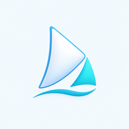
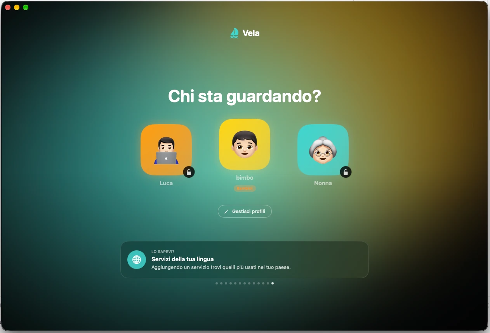
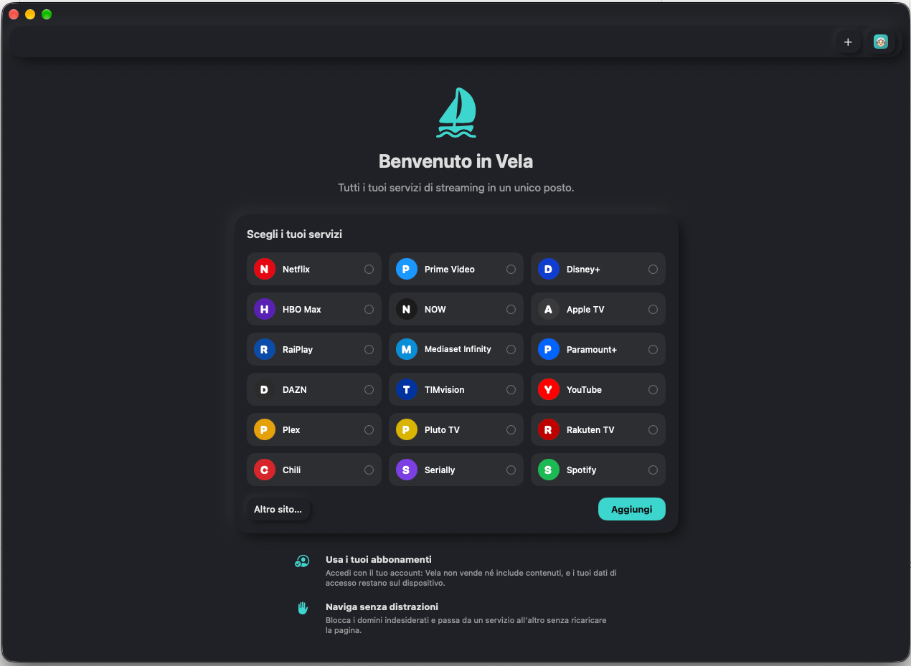
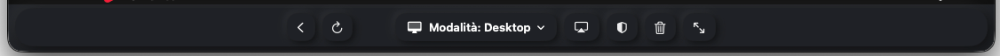

# Vela

**Tutti i tuoi servizi di streaming in un unico posto.**

Un'app nativa per Mac che riunisce Netflix, Prime Video, Disney+, RaiPlay, YouTube, Spotify e qualsiasi altro sito
di streaming: profili separati per ogni persona di casa, profilo Bambini protetto, Picture in Picture e niente
distrazioni. Usi i tuoi abbonamenti, con i tuoi accessi, che restano sul tuo dispositivo.

*Di Luca Sarandrea.*

 

 

&nbsp;

[Sito di Vela](https://vela.l-sarandrea.workers.dev) · [Novità](https://github.com/lsarandrea/Vela-releases/discussions/categories/announcements) · [Scrivici](https://vela-sync.l-sarandrea.workers.dev/feedback)

 

---

## Funzioni

  
   Al primo avvio scegli i tuoi servizi con un clic, tra quelli più usati nel tuo paese.

  
   La barra di ogni servizio: modalità Desktop, Tablet o Smartphone, AirPlay, filtri, schermo intero.

| | Gratis | Vela Pro |
| --- | :---: | :---: |
| Servizi di streaming per profilo | 5 | illimitati |
| Profili (ognuno con servizi, accessi e tema suoi) | 3 | illimitati |
| Profilo Bambini protetto dal PIN degli adulti | ✓ | ✓ |
| Picture in Picture e mini player | ✓ | ✓ |
| Modalità Desktop, Tablet o Smartphone per ogni sito | ✓ | ✓ |
| Blocco di pop-up e domini indesiderati | ✓ | ✓ |
| Temi Standard e Morbido | ✓ | ✓ |
| Tema Vetro, con le barre che galleggiano sul sito | | ✓ |
| Sincronizzazione cifrata tra i tuoi dispositivi | | ✓ |
| AirPlay | | ✓ |
| Aggiornamenti che si installano da soli | | ✓ |
| Invita un amico: 3 licenze Vela Pro da regalare | | ✓ |

Vela Pro è un acquisto unico da 1,99 €, valido su 3 dispositivi. Si compra dall'app (Generale → Vela Pro):
il codice compare subito dopo il pagamento e arriva anche per email.

## Installazione

1. Scarica [**Vela.dmg**](https://github.com/lsarandrea/Vela-releases/releases/latest/download/Vela.dmg), aprilo e
   trascina Vela in **Applicazioni**.
2. Al primo avvio macOS potrebbe bloccarla: apri **Impostazioni di Sistema → Privacy e sicurezza** e scegli
   **Apri comunque**. Serve solo la prima volta.
3. Gli aggiornamenti arrivano dall'app (Generale → Aggiornamenti): un pallino rosso sul profilo ti avvisa.

Requisiti: macOS 14.6 o successivo, Mac con Apple Silicon o Intel.

## Versioni beta

Le novità escono prima come **beta**, nella sezione [Releases](https://github.com/lsarandrea/Vela-releases/releases)
con l'etichetta *Pre-release*, e diventano ufficiali dopo le prove. Per riceverle in automatico attiva
**Generale → Aggiornamenti → Ricevi le versioni beta**. Le beta possono avere qualche difetto: segnalalo nelle
[discussioni](https://github.com/lsarandrea/Vela-releases/discussions) o con il [modulo di feedback](https://vela-sync.l-sarandrea.workers.dev/feedback).

## Privacy

- Gli accessi ai servizi restano sul tuo dispositivo, separati per profilo. Vela non vende né include contenuti.
- La sincronizzazione di Vela Pro è **cifrata sul dispositivo**: il server conserva solo dati illeggibili.
- Nessun tracciamento e nessuna pubblicità.

## Supporto

- **Domande, idee e voti sulle prossime funzioni:** [discussioni su GitHub](https://github.com/lsarandrea/Vela-releases/discussions)
- **Un problema o un servizio che manca:** dall'app, *Supporto → Invia un feedback*, oppure dal [modulo sul web](https://vela-sync.l-sarandrea.workers.dev/feedback)
- **Licenze e acquisti:** rispondi all'email con il tuo codice licenza

---

<b>English</b>

**Vela — all your streaming services in one place.** A native Mac app that brings together Netflix, Prime Video,
Disney+, YouTube, Spotify and any other streaming site, with separate profiles for everyone at home, a
PIN-protected Kids profile, Picture in Picture and no distractions. You use your own subscriptions and logins,
which stay on your device. Available in English, Italian, French, Spanish and Russian.

[Download for Mac](https://github.com/lsarandrea/Vela-releases/releases/latest/download/Vela.dmg) ·
[Website](https://vela.l-sarandrea.workers.dev) · [Discussions](https://github.com/lsarandrea/Vela-releases/discussions) ·
[Feedback](https://vela-sync.l-sarandrea.workers.dev/feedback)

Requires macOS 14.6 or later (Apple Silicon or Intel). On first launch, if macOS blocks the app, open
System Settings → Privacy & Security and choose **Open Anyway**. Vela Pro (one-time €1.99, 3 devices) unlocks
unlimited services and profiles, the Glass theme, encrypted sync, AirPlay, automatic updates and 3 gift licenses
for friends. New versions ship as betas first (Pre-release); turn on General → Updates → Get beta versions to
receive them.

Questo repository contiene solo le versioni pubblicate di Vela (DMG e aggiornamenti); il codice sorgente è privato.
Vela non è affiliata ai servizi di streaming citati: i loro nomi appartengono ai rispettivi proprietari.
